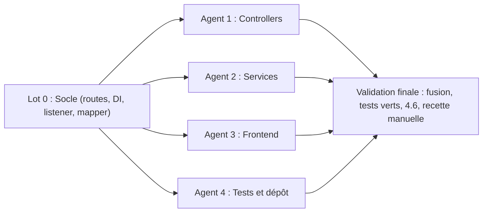

# 📋 Plan de Répartition des Tâches Multi-Agents — FolderCast (v2 auditée)

Ce document découpe les corrections et améliorations issues de l'audit technique en **lots indépendants (Workstreams)**. Chaque lot est conçu pour être confié à un agent autonome distinct en minimisant les conflits de fusion (découpage par périmètre fonctionnel et **propriété exclusive des fichiers**).

> **Règle d'or** : un fichier n'appartient qu'à **un seul lot**. Si un agent a besoin de modifier un fichier qui ne lui appartient pas, il le signale au lieu de le modifier.

---

## 🧭 Décisions d'architecture arrêtées (à respecter par tous les agents)

| Sujet | Décision |
|---|---|
| Injection de dépendances | Suppression des `registerService()` manuels dans `Application.php` → **autowiring** Nextcloud. Les agents peuvent modifier librement les constructeurs des services/contrôleurs. |
| Doublon de flux (`create`) | Idempotent : si un flux existe déjà pour `(folderId, userId)`, retourner **`200` avec le flux existant** et `"existing": true`. Pas de nouveau token. |
| Autoremove | **Retiré de `generateXml()`** (une requête publique anonyme ne doit jamais supprimer de fichiers). Déplacé dans un `TimedJob` (`lib/BackgroundJob/CleanupOldEpisodes.php`). |
| Clé de config `flatten` | Conservée pour compatibilité. Sémantique : `true` = **inclure les sous-dossiers** (défaut `true`, comportement actuel). |
| URL du flux côté UI | Toujours **absolue** (`window.location.origin + generateUrl(...)`) : une URL relative est inutilisable dans une app podcast. |
| Fichiers servis par token | Uniquement les **épisodes publiés dans le flux** (audio/vidéo, non cachés, respect de `flatten`) + logo + covers. Jamais `podcast.json` ni d'autres fichiers du dossier. |

---

## 🛠️ Commandes de vérification communes (À exécuter par chaque agent)

- **Vérification PHP & Tests unitaires** : `make test-php`
- **Build & Vérification JS/Vue** : `make test-js`
- **Vérification globale** : `make test-all`

> [!IMPORTANT]
> - `composer` n'est pas installé localement : le `Makefile` bascule sur l'image Docker `composer`. Docker doit être disponible.
> - `package-lock.json` et `composer.lock` sont **ignorés par Git** (`.gitignore`). Dans un workspace cloné/branché, `npm ci` (utilisé par `make test-js`) **échouera** et `vendor/` sera absent. Lancer `composer install` (avec dev, pas `make composer` qui fait `--no-dev`) et `npm install --legacy-peer-deps` si besoin, en attendant la tâche 4.4.
> - Constat actuel : `make test-php` affiche « OK » mais **les 2 tests existants sont `skipped`** (les interfaces `OCP\` ne sont pas autoloadées). Un vert actuel ne prouve rien — voir tâche 4.1.

---

## 🧱 Lot 0 : Socle préalable (séquentiel, AVANT les agents 1-4)

**Objectif** : traiter les fichiers partagés par plusieurs lots pour supprimer toute dépendance croisée. Petit lot (~30 min), à faire par un seul agent puis à fusionner avant de lancer les autres.

### Fichiers (propriété exclusive du Lot 0)
- `appinfo/routes.php`
- `lib/AppInfo/Application.php`
- `lib/Listener/LoadAdditionalScriptsListener.php` (à créer)
- `lib/Db/FeedMapper.php`

### Tâches
- [x] **0.1. Nettoyage de `appinfo/routes.php`** : supprimer la route en doublon `Api#update` (`PUT /api/feeds/{id}`, lignes 35-39).
- [x] **0.2. Passage à l'autowiring dans `Application::register()`** : supprimer les trois `registerService()` (ils utilisent `$c->query()`, déprécié, et figent les signatures de constructeurs — tout ajout de dépendance par l'Agent 2 casserait l'app au runtime sans qu'aucun test ne le détecte).
- [x] **0.3. Chargement conditionnel du script Files** :
  - Supprimer `\OCP\Util::addScript('foldercast', 'foldercast-files')` de `boot()` (actuellement injecté sur **toutes** les pages Nextcloud).
  - Créer `lib/Listener/LoadAdditionalScriptsListener.php` (`implements IEventListener<LoadAdditionalScriptsEvent>`) qui appelle `\OCP\Util::addInitScript(Application::APP_ID, 'foldercast-files')`. `addInitScript` est requis depuis NC 28 pour que l'action soit enregistrée avant l'initialisation de l'app Fichiers.
  - Dans `register()` : `$context->registerEventListener(\OCA\Files\Event\LoadAdditionalScriptsEvent::class, LoadAdditionalScriptsListener::class);`
- [x] **0.4. Méthodes de mapper nécessaires aux autres lots** dans `FeedMapper` :
  - `findByFolderIdAndUserId(int $folderId, string $userId): ?Feed` — utiliser `findEntities()` + retourner le premier élément (la base peut **déjà contenir des doublons** : `findEntity()` lèverait `MultipleObjectsReturnedException`). Le `findByFolderId()` existant ne filtre pas l'utilisateur alors qu'un dossier partagé a le **même fileId** pour le propriétaire et le destinataire.
  - `findAll(): array` (pour le job de nettoyage de l'Agent 2).

### Critères d'acceptation
- Aucune route dupliquée ; l'app démarre (`occ app:enable foldercast`) sans erreur de DI.
- Le script `foldercast-files.js` n'est plus chargé hors de l'app Fichiers.

---

## 🛡️ Agent 1 : Sécurité, Contrôleurs API & Streaming HTTP (`Controller`)

**Objectif** : sécuriser les endpoints, migrer vers les attributs PHP 8, implémenter le support HTTP `Range` (`206 Partial Content`) indispensable pour Apple Podcasts et le seeking audio.

### Fichiers (propriété exclusive)
- `lib/Controller/ApiController.php`
- `lib/Controller/FeedController.php`
- `lib/Http/RangeStreamResponse.php` (à créer)

### Tâches
- [x] **1.1. Attributs d'accès sur `ApiController.php`** :
  - Ajouter `#[NoAdminRequired]` sur `index`, `create`, `update`, `destroy`, `uploadLogo`. **Bug bloquant actuel** : sans annotation, Nextcloud réserve ces routes aux administrateurs.
  - Conserver la protection CSRF (ne pas ajouter `NoCSRFRequired` : `@nextcloud/axios` envoie le `requesttoken`).
- [x] **1.2. Migration de `FeedController.php` vers les attributs PHP 8** : remplacer les DocBlocks `@NoAdminRequired`, `@NoCSRFRequired`, `@PublicPage` de `show`, `download`, `logo`, `cover` par `#[NoAdminRequired]`, `#[NoCSRFRequired]`, `#[PublicPage]` (`OCP\AppFramework\Http\Attribute\*`).
- [x] **1.3. Ne plus divulguer les messages d'exception** (endpoints publics) : remplacer `['error' => $e->getMessage()]` par une réponse générique (`404` vide) et journaliser via `LoggerInterface` (à injecter). Distinguer `DoesNotExistException` (404) du reste (500 + log). Idem `uploadLogo()` (message générique côté client).
- [x] **1.4. Validation et déduplication dans `ApiController::create()`** :
  - Valider `$podcastName` : `trim()`, non vide, longueur ≤ 200, puis `\OCP\Files\IFilenameValidator::validateFilename()` (NC 30+, gère `/`, `\`, `..`, noms réservés). Retourner `400` en cas d'échec.
  - Vérifier que le nœud `$folderId` est bien une instance de `OCP\Files\Folder` (aujourd'hui on peut créer un flux sur un **fichier**) et qu'il est lisible (`isReadable()`).
  - Avant `insert()`, appeler `$this->mapper->findByFolderIdAndUserId($folderId, $uid)` (Lot 0). Si trouvé → retourner le flux existant avec `existing: true` (cf. Décisions).
- [x] **1.5. Liste blanche de configuration dans `ApiController::update()`** :
  - Aujourd'hui `array_merge` accepte **n'importe quelle clé**, y compris `logoFileId` (contrôlé par le serveur) → n'accepter que : `title`, `description`, `author` (string, ≤ 4000 car.), `imageUrl` (vide ou `filter_var(FILTER_VALIDATE_URL)` en `http(s)` uniquement), `autoremoveDays` (int 0-3650), `flatten` (bool), `sortBy` (`date_desc` | `date_asc` | `name`).
  - Gérer `json_decode` qui retourne `null` (config corrompue) → `[]`.
- [x] **1.6. Sécurisation de `ApiController::uploadLogo()`** :
  - Vérifier `$uploadedFile['error'] === UPLOAD_ERR_OK` et `is_uploaded_file()`; taille max 5 Mo.
  - Déterminer le type réel via `finfo_file()` (ou `IMimeTypeDetector::detectPath`) et n'accepter que `image/jpeg`, `image/png`, `image/webp`, `image/gif`. **Dériver l'extension du MIME détecté**, jamais du nom fourni par le client (SVG exclu : risque XSS).
  - Supprimer tout ancien `_logo.*` du dossier avant d'écrire le nouveau.
  - Fermer le flux dans un `finally`.
- [x] **1.7. Support HTTP Byte-Range dans `FeedController::download()`** :
  - ⚠️ `StreamResponse` diffuse **tout** le flux jusqu'à EOF : il est impossible de limiter la longueur avec. Créer `lib/Http/RangeStreamResponse.php` (`extends Response implements ICallbackResponse`) dont `callback()` copie exactement `$length` octets (`stream_copy_to_stream($stream, fopen('php://output','wb'), $length)`).
  - Extraire le parsing dans une **fonction pure testable** : `RangeStreamResponse::parseRange(?string $header, int $size): array|null|false` (`null` = pas de Range → 200, `false` = 416, sinon `[start, end]`). Gérer `bytes=0-1023`, `bytes=500-` et le suffixe `bytes=-500`; plages multiples → ignorer et servir en 200.
  - En-têtes : `Accept-Ranges: bytes` toujours ; en 206 `Content-Range: bytes start-end/total` et `Content-Length: end-start+1` ; en 416 `Content-Range: bytes */total`.
  - Positionnement : `fseek($stream, $start)`; si le flux n'est pas seekable (stockage externe, chiffrement), lire et jeter `$start` octets par blocs de 8 Ko.
  - `Content-Type` : ne jamais renvoyer `application/octet-stream` pour un épisode ; utiliser le MIME déduit de l'extension (même table que la tâche 2.6, ou `audio/mpeg` par défaut).
  - `Content-Disposition` : `inline; filename="<nom ASCII sans " \r \n>"; filename*=UTF-8''<rawurlencode(nom)>` (`addslashes` ne protège ni des CRLF ni des accents).
- [x] **1.8. (Optionnel) Cache HTTP du flux dans `show()`** : renvoyer un `ETag` (hash du XML) et répondre `304 Not Modified` si `If-None-Match` correspond — les clients podcast interrogent le flux très souvent.

### Critères d'acceptation
- Un utilisateur non-admin peut appeler toutes les routes de `ApiController`.
- `curl -H 'Range: bytes=0-1023' -D- -o /dev/null <url audio>` → `206`, `Content-Range: bytes 0-1023/<taille>`, `Content-Length: 1024`, **1024 octets reçus**.
- `Range: bytes=<taille>-` → `416`. `curl -I` (HEAD) renvoie les en-têtes sans corps.
- Uploader un `.php` renommé en `.png` → `400`. Recréer un flux sur le même dossier → même token.

---

## ⚙️ Agent 2 : Services Métier, Flux RSS, Cache & Nettoyage (`Service`)

**Objectif** : corriger les failles d'accès aux fichiers, rendre le XML robuste et conforme RSS 2.0 / Apple Podcasts, supprimer la suppression de fichiers déclenchée par une requête publique, et éliminer les copies répétées de fichiers audio vers `/tmp`.

### Fichiers (propriété exclusive)
- `lib/Service/FeedService.php`
- `lib/Service/MetadataService.php`
- `lib/BackgroundJob/CleanupOldEpisodes.php` (à créer)
- `appinfo/info.xml` (uniquement la section `<background-jobs>`)

### Tâches
- [x] **2.1. Correction de la faille Path Prefix Bypass dans `FeedService::getFile()`** :
  ```php
  $folderPrefix = rtrim($feedFolder->getPath(), '/') . '/';
  if (!($file instanceof File) || !str_starts_with($file->getPath(), $folderPrefix)) {
      return null;
  }
  ```
  - Vérifier aussi que `$feedFolder instanceof Folder`.
- [x] **2.2. Restreindre `getFile()` aux épisodes du flux** : aujourd'hui, le token donne accès à **n'importe quel fichier** du dossier (documents, `podcast.json`, sous-dossiers même si `flatten=false`). Factoriser un prédicat `isEpisode(File $file, Folder $root, bool $recursive): bool` réutilisé par `scanFolder()` et `getFile()` (même dossier parent si non récursif, MIME audio/vidéo, pas de fichier caché).
- [x] **2.3. Nettoyage de `FeedService::getLogoFile()`** : supprimer le double `return $nodes[0];` (lignes 124-125) et vérifier `$nodes[0] instanceof File`. Ajouter le fallback `cover.jpg`/`cover.png` (cf. 2.6).
- [x] **2.4. Exclusion des fichiers techniques dans `scanFolder()`** : ignorer fichiers **et dossiers** commençant par `.`, les `_logo.*`, `cover.*`, `podcast.json`, même si leur MIME est `application/octet-stream`. Pour `octet-stream`, n'accepter que les extensions audio connues (`mp3`, `m4a`, `m4b`, `aac`, `ogg`, `oga`, `opus`, `flac`, `wav`, `mp4`, `m4v`).
- [x] **2.5. Extraction de l'autoremove vers un `TimedJob`** :
  - Supprimer intégralement le bloc autoremove de `generateXml()` (**faille critique** : n'importe quel lecteur du flux public déclenche des suppressions, et le code supprime aussi les fichiers non-audio).
  - Créer `FeedService::cleanupOldEpisodes(Feed $feed): int` qui ne supprime **que** les fichiers retournés par `scanFolder()` (donc respectant `flatten` et les exclusions), puis vide le cache du flux.
  - Créer `lib/BackgroundJob/CleanupOldEpisodes.php` (`extends OCP\BackgroundJob\TimedJob`, intervalle 6 h, `setTimeSensitivity(TIME_INSENSITIVE)`) qui itère `FeedMapper::findAll()` (Lot 0) et appelle `cleanupOldEpisodes()` pour les flux avec `autoremoveDays > 0`.
  - Déclarer le job dans `appinfo/info.xml` : `<background-jobs><job>OCA\FolderCast\BackgroundJob\CleanupOldEpisodes</job></background-jobs>`.
- [x] **2.6. XML robuste et conforme dans `generateXml()`** :
  - **Échappement** : remplacer `htmlspecialchars()` par un helper `xml(string): string` = suppression des caractères interdits en XML 1.0 (`/[^\x{9}\x{A}\x{D}\x{20}-\x{D7FF}\x{E000}-\x{FFFD}\x{10000}-\x{10FFFF}]/u`) + `htmlspecialchars($s, ENT_XML1 | ENT_QUOTES | ENT_SUBSTITUTE, 'UTF-8')`. Les tags ID3 contiennent souvent des `\x00` qui rendent **tout le flux invalide**. (Alternative acceptable : `XMLWriter`.)
  - **Canal** : ajouter `<link>` (URL absolue de l'app), `<language>` (config ou `fr`), `<lastBuildDate>`, `<atom:link href="<url du flux>" rel="self" type="application/rss+xml"/>` (déclarer `xmlns:atom`), `<itunes:explicit>false</itunes:explicit>`, `<itunes:category text="..."/>` (exigés par Apple).
  - **Image du canal** (ordre) : logo uploadé > `imageUrl` > `cover.jpg`/`cover.png` du dossier (promis par le `README.md`, servi via la route `logo`).
  - **Items** : `<guid isPermaLink="false">foldercast-{feedId}-{fileId}</guid>`; `type` de l'`<enclosure>` déduit de l'extension si le MIME est `application/octet-stream` (`mp3→audio/mpeg`, `m4a/m4b→audio/mp4`, `ogg/oga→audio/ogg`, `opus→audio/opus`, `mp4→video/mp4`…); `<link>` d'item seulement si `$meta['url']` passe `FILTER_VALIDATE_URL` (le tag ID3 « comment » n'est pas forcément une URL); `<itunes:duration>` casté en `int`.
  - **Tri déterministe** : par date de publication (date ID3 sinon `mtime`) décroissante par défaut, ou selon `config.sortBy` (`date_asc`, `name` via `strnatcasecmp`).
- [x] **2.7. Invalidation automatique du cache du flux** : la clé actuelle `feed_xml_{token}` laisse les nouveaux épisodes invisibles jusqu'à 1 h. Utiliser `feed_xml_v2_{token}_{etag du dossier}_{md5(configuration)}` : l'ETag d'un dossier Nextcloud change à chaque modification de son contenu (sous-dossiers inclus). `clearCache()` reste disponible pour l'API.
- [x] **2.8. Correction du double encodage dans `MetadataService::getMetadata()`** : lire `$fileInfo['comments']` (UTF-8 brut) au lieu de `$fileInfo['comments_html']`, sinon `L'État` devient `l&amp;#039;&amp;Eacute;tat` après échappement.
- [x] **2.9. Performance de `MetadataService`** :
  - Injecter `ICacheFactory` (autowiring, cf. Lot 0) et mettre en cache le tableau de `getMetadata()` sous `meta_v1_{fileId}_{mtime}_{size}` (TTL 30 jours, **sans** les données binaires de la cover).
  - Éviter la copie intégrale du fichier : utiliser `$file->getStorage()->getLocalFile($file->getInternalPath())`, qui renvoie le **chemin réel** pour un stockage local et ne fait une copie temporaire (gérée par Nextcloud) que pour les stockages distants/chiffrés.
  - ⚠️ Dans ce cas, **ne jamais `unlink()`** le chemin retourné (ce serait le fichier original de l'utilisateur !). Supprimer le bloc `finally` actuel ou ne l'appliquer qu'aux copies créées par le service lui-même.
  - Si la copie manuelle est conservée en fallback : fermer `$source`/`$dest` dans un `finally`.
  - (Optionnel) Mettre en cache les octets de cover ≤ 512 Ko pour l'endpoint `cover`.

### Critères d'acceptation
- Les caractères spéciaux (`'`, `&`, `<`, accents, `\x00`) dans les tags ID3 produisent un XML **valide** (`xmllint --noout`) sans double échappement.
- Un fichier de `/PodcastSecret/ep.mp3` ou `/Podcast/notes.pdf` n'est **pas** téléchargeable avec le token de `/Podcast`.
- Un `GET` anonyme sur le flux ne supprime jamais de fichier ; le job `CleanupOldEpisodes` ne supprime que des épisodes.
- Ajouter un fichier dans le dossier → il apparaît au prochain `GET` du flux, sans attendre 1 h.
- Une 2ᵉ génération du flux ne ré-analyse pas les fichiers inchangés via `getID3`.

---

## 🎨 Agent 3 : Interface Vue.js & Intégration Nextcloud Files (`Frontend`)

**Objectif** : réparer l'action dans l'app Fichiers (aujourd'hui **inopérante** sur NC 30+), fiabiliser le tableau de bord, ajouter les options manquantes.

### Fichiers (propriété exclusive)
- `src/App.vue`, `src/files.js`, `src/main.js`
- `package.json` (dépendances front)

### Tâches
- [x] **3.1. Réécriture de `src/files.js` avec l'API moderne** :
  - `OCA.Files.fileActions` **n'existe plus depuis NC 28** (app Fichiers réécrite en Vue) : l'action « Turn into Podcast » n'apparaît donc pas sur la cible NC 30-32. Ce n'est pas une « vérification », c'est une réécriture.
  - Utiliser `registerFileAction(new FileAction({ id: 'foldercast', displayName, iconSvgInline, enabled: (nodes) => nodes.length === 1 && nodes[0].type === FileType.Folder, exec: async (node) => {...} }))` de `@nextcloud/files` (^3), **sans** `DOMContentLoaded` (le script est chargé via `addInitScript`, Lot 0).
  - Après création, afficher l'**URL RSS absolue** avec un bouton « Copier » (`@nextcloud/dialogs`), y compris si le flux existait déjà (`existing: true`).
- [x] **3.2. Fiabilisation de `src/App.vue`** :
  - Parser `feed.configuration` une seule fois dans `fetchFeeds()` (`try/catch`, défaut `{}`) → `feed.config`. Plus aucun `JSON.parse` dans le template (ligne 75) ni dans `openEdit()`.
  - `URL.revokeObjectURL()` sur l'ancienne URL blob dans `onLogoSelected()` et dans `closeModal()` (uniquement si elle commence par `blob:`).
  - Ligne 156 : supprimer le no-op `.replace('/feed/', '/feed/')`.
  - Supprimer les `console.log` de debug et les imports inutilisés (`getRequestToken` dans `App.vue` et `main.js`).
- [x] **3.3. Améliorations UX dans `src/App.vue`** :
  - `getFeedUrl()` doit retourner une **URL absolue** (`window.location.origin + generateUrl(...)`) — l'URL relative actuelle est inutilisable dans une app podcast.
  - Bouton **« Copier le lien RSS »** : `navigator.clipboard.writeText()` avec fallback (sélection d'un `<input readonly>`) car l'API Clipboard exige HTTPS ; confirmation via `showSuccess()`.
  - Case **« Inclure les sous-dossiers »** liée à `editForm.flatten`, initialisée à `config.flatten ?? true` (défaut backend).
  - Sélecteur **« Ordre des épisodes »** (`editForm.sortBy` : plus récent d'abord / plus ancien d'abord / par nom).
  - Autoremove : avertissement explicite + confirmation lorsque la valeur passe de 0 à > 0 (suppression **définitive** des épisodes, via la corbeille) ; corriger la coquille « DELETE ».
  - Remplacer `alert()` et `OC.Notification.showTemporary` par `showSuccess` / `showError` de `@nextcloud/dialogs`.
  - Envelopper toutes les chaînes dans `t('foldercast', ...)`.
- [x] **3.4. Dépendances** : ajouter `@nextcloud/files` (^3) et `@nextcloud/dialogs` (^5, dernière version compatible Vue 2.7) à `package.json`; vérifier que `make test-js` produit toujours `js/foldercast-main.js` et `js/foldercast-files.js`.
- [ ] **3.5. (Optionnel) Composants natifs** : remplacer les modales/boutons faits main par `NcModal`, `NcButton`, `NcCheckboxRadioSwitch`, `NcTextField` (`@nextcloud/vue` v7) pour le thème sombre et l'accessibilité.

### Critères d'acceptation
- Sur NC 30+, l'entrée « Turn into Podcast » apparaît dans le menu d'un dossier et uniquement d'un dossier.
- `make test-js` compile sans erreur ; aucun `JSON.parse` dans le template ; aucune fuite de `URL.createObjectURL`.
- Le lien copié commence par `https://` et fonctionne tel quel dans une app podcast.

---

## 🧪 Agent 4 : Tests, Build, Dépôt & Documentation (`QA & Tooling`)

**Objectif** : obtenir une suite de tests qui s'exécute réellement, assainir le dépôt et aligner la documentation.

### Fichiers (propriété exclusive)
- `tests/**` (dont `tests/bootstrap.php`, `tests/fixtures/`)
- `README.md`, `CHANGELOG.md`, `TODO.md`
- `webpack.js`, `.gitignore`, `.gitignore.bak`, `chunks/`, `assets/`, `Makefile`, `composer.json`

### Tâches
- [x] **4.1. Rendre les tests exécutables** (prérequis à tout le reste) :
  - Dans `tests/bootstrap.php`, quand le bootstrap Nextcloud est absent, enregistrer l'autoload des stubs : `$loader = require __DIR__ . '/../vendor/autoload.php'; $loader->addPsr4('OCP\\', __DIR__ . '/../vendor/nextcloud/ocp/OCP');` (+ `NCU\\` si nécessaire).
  - Objectif : **0 test `skipped`** dans `make test-php`.
- [x] **4.2. Fixture audio libre de droits** :
  - Le MP3 Mediapart actuel (3,6 Mo, versionné) pose un **problème de droits d'auteur** dans un dépôt public AGPL et son nom (espaces, accents) fragilise les scripts. Le remplacer par `tests/fixtures/episode.mp3` (quelques secondes de silence/sinus) généré par `ffmpeg` ou par `getid3_writetags` (déjà dans `vendor/`), avec titre `L'État & l'université <test>`, artiste accentué, date, cover APIC PNG, et un `\x00` parasite dans un champ. Supprimer l'ancien fichier (`git rm`).
- [x] **4.3. Nouveaux tests unitaires** :
  - `tests/unit/Service/MetadataServiceTest.php` : mock `OCP\Files\File` dont `fopen()`/storage pointent vers la fixture ; vérifier titre sans double échappement, durée, `has_cover`, et que le cache évite une 2ᵉ analyse.
  - `tests/unit/Service/FeedServiceTest.php` : génération XML (valide via `simplexml_load_string`, guid, tri, enclosure `audio/mpeg` pour un `.mp3` en `octet-stream`) ; sécurité de `getFile()` (rejet `/PodcastSecret/...`, rejet d'un `.pdf` du dossier, rejet sous-dossier si `flatten=false`) ; `generateXml()` ne supprime jamais de fichier.
  - `tests/unit/Http/RangeStreamResponseTest.php` : table de cas pour `parseRange()` (`bytes=0-1023`, `bytes=500-`, `bytes=-500`, hors bornes → 416, multi-plages, en-tête invalide).
  - Compléter `tests/unit/Controller/ApiTest.php` : `create` (nominal, nom invalide `../x` → 400, doublon → même token), `update` (liste blanche : `logoFileId` ignoré), `destroy`, et `403` sur le flux d'un autre utilisateur. Corriger le namespace (`OCA\FolderCast\Tests\Unit\Controller`).
  - Écrire ces tests **contre les contrats définis dans ce plan** ; ils peuvent démarrer en parallèle et seront rendus verts après fusion des Agents 1-2.
- [x] **4.4. Assainissement du dépôt et du build** :
  - Supprimer `webpack.js` (Vite via `vite.config.mjs`), les dossiers orphelins `chunks/` et `assets/` (versionnés, non référencés, mais embarqués dans l'archive par `make appstore`) et `.gitignore.bak`.
  - `.gitignore` : **versionner** `package-lock.json` (requis par `npm ci` dans `make test-js`) et `composer.lock` (version de getID3 reproductible) ; ancrer les motifs `main.js`/`files.js` à la racine (`/main.js`, `/files.js`) — tels quels, ils ignorent aussi tout nouveau `src/main.js`.
  - `Makefile` : ajouter `.phony` manquants (`clean composer npm appstore`), et une cible `lint-php` (`composer psalm`) optionnelle.
- [x] **4.5. `README.md`** :
  - La ligne 49 (`## sudo tar ...`) est une **modification locale non commitée** : `git restore README.md` suffit si c'est la seule.
  - Prérequis : `Nextcloud 30 – 32` (au lieu de `28+`), conformément à `appinfo/info.xml`.
  - Corriger « Recursive Scanning … (default: flattened) » : les sous-dossiers sont inclus par défaut (`flatten: true`).
  - Documenter : tri des épisodes, fallback `cover.jpg`/`cover.png`, autoremove exécuté par tâche cron (prérequis : cron Nextcloud configuré), copie du lien RSS.
- [x] **4.6. Version & CHANGELOG** (en toute fin, après fusion) : passer `<version>` à `1.4.0` dans `appinfo/info.xml` et `package.json` (requis pour que Nextcloud enregistre le nouveau background job), et rédiger l'entrée `CHANGELOG.md` (section *Security* incluse). Cocher les entrées réalisées de `TODO.md` (« Large file downloads », « File Hooks » partiellement couvert par 2.7).

### Critères d'acceptation
- `make test-php` : tous les tests passent, **aucun `skipped`**.
- `make test-js` fonctionne depuis un clone propre.
- `README.md` est propre et cohérent avec `appinfo/info.xml`.

---

## 🔄 Ordre d'exécution recommandé



1. **Lot 0** seul, fusionné avant tout le reste.
2. **Agents 1, 2, 3, 4 en parallèle** (fichiers disjoints). L'Agent 4 commence par 4.1 / 4.2 / 4.4 / 4.5, puis écrit les tests contre les contrats.
3. **Validation finale** : fusion, `make test-all`, tâche 4.6, puis recette manuelle ci-dessous.

## ✅ Recette manuelle finale (instance NC 30+)

- [ ] Utilisateur **non-admin** : créer un podcast depuis le tableau de bord **et** depuis le menu d'un dossier dans Fichiers.
- [ ] Recréer sur le même dossier → même URL.
- [ ] `xmllint --noout <(curl -s <url du flux>)` → aucun message.
- [ ] Ajouter un MP3 → visible immédiatement dans le flux.
- [ ] `curl -D- -H 'Range: bytes=0-1023' -o /dev/null <url épisode>` → `206`.
- [ ] Tenter `<url>/audio/<fileId d'un fichier hors dossier ou .pdf>` → `404`.
- [ ] Abonnement réel dans une app (AntennaPod / Apple Podcasts) : lecture et avance rapide fonctionnelles.
- [ ] `occ background-job:list | grep FolderCast` → job présent ; avec `autoremoveDays=1` et un vieux fichier, `occ background-job:execute <id> --force-execute` ne supprime que l'épisode.
